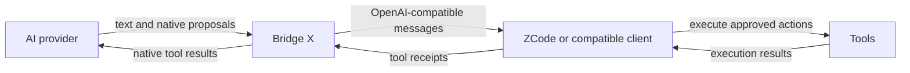

# Bridge X

**A local OpenAI-compatible gateway for client-owned AI agent workflows.**

Bridge X translates provider responses into Chat Completions messages, validates proposed tool calls against the client's schemas, and records client execution receipts in SQLite. It connects clients such as ZCode to a configured upstream while keeping tool execution on the client.

## Demo


*Animated architecture illustration of the verified tool workflow.*

[Alternative: execution ledger](docs/assets/bridge-x-demo-ledger.gif) · [Demo scope and creation](docs/DEMO.md)

**Stable version: 12.13.1 · Python: 3.11+**

This release opens a native Windows proxy monitor from `start.bat`, with ENG/RUS, real request timings, rotating metadata logs and offline diagnostics. Long-session context recovery and receipt reconciliation are retained. The [investigation](docs/AGENT_CONTINUITY.md) distinguishes verified protocol repairs from external model behavior.

[Quick Start](#quick-start) · [Configuration](docs/CONFIGURATION.md) · [Architecture](docs/ARCHITECTURE.md) · [File guide](docs/FILE_GUIDE.md) · [Testing](docs/TESTING.md) · [Contributing](CONTRIBUTING.md)

[Download releases](https://github.com/MisterBread1/bridge-x-agent-gateway/releases) · [Automated checks](https://github.com/MisterBread1/bridge-x-agent-gateway/actions)

Use the offline simulator to check installation first. A successful local test does not establish live-provider availability or certify an installed client.

## Features

- Streaming and non-streaming `/v1/chat/completions` responses.
- Native Molab frontend tool events validated against the client's JSON Schema.
- Sequential tool delivery, matching tool results, and independent execution scopes for foreground and memory tasks.
- SQLite recovery with protection against repeating unconfirmed mutations.
- Bounded recovery from explicit rate rejections before any answer or tool input.
- Offline HTTP and real local file/terminal acceptance checks without provider credentials.

## Architecture



The gateway validates and delivers calls. The client executes tools. A proposed call is not evidence of execution. See the [request, tool, and recovery flows](docs/ARCHITECTURE.md).

## Requirements

- Python 3.11 or newer (the code uses `StrEnum`). The earlier public-release acceptance report records Windows 11 / Python 3.13.13; other Python versions and operating systems are not certified by that report.
- The pinned packages in `requirements.txt`; `requirements-dev.txt` adds the test tools.
- A compatible client for interactive agent work. Molab requires a current operator-supplied runtime configuration. A notebook URL alone is insufficient.

## Windows app

1. Extract the complete release ZIP and double-click **`start.bat`**. The native window opens and starts the Molab proxy automatically; simulator mode cannot override this default launch.
2. Existing Molab settings are reused. On a new installation, open **Connection** and enter or import your runtime settings.
3. Keep the ZCode model **`molab-glm`** and the usual local API address. Send a request: its POST code, queue time and provider time appear in **Requests**.

Choose **ENG / RUS** in the top right. The app needs no browser, window login or manual `local.key` setup. **Run diagnostics** checks the installation; **Save report** exports sanitized metadata. Filter errors and active requests without losing the full recent history. [Native window and upgrade guide](docs/WORKBENCH.md).

## Quick Start

Windows shortcut: double-click `start.bat`. It prepares `.venv` and missing runtime dependencies, then opens the native app using `pythonw`. Python 3.11+ with Tcl/Tk must be available through `py -3` or `python`; first-time installation needs package-download access. Explicit arguments retain terminal operation, for example `start.bat --headless --provider fake --port 18787`. `start-ui.bat` remains a native-app alias.

Clone this repository or extract the prepared release ZIP. In PowerShell, open the project directory containing `requirements.txt`. The commands below use a test port, **18787**, so an existing gateway on 8787 can remain running.

```powershell
python -m venv .venv
.\.venv\Scripts\python.exe -m pip install -r requirements.txt
.\.venv\Scripts\python.exe -m bridge_x --provider fake --port 18787
```

The **fake** provider is an offline protocol simulator; it requires no account or Molab configuration and is not an AI model. Leave the server terminal open. In another PowerShell terminal:

```powershell
Invoke-RestMethod http://127.0.0.1:18787/health
```

Expect `status: ok`, version `12.13.1`, and provider `fake`. The Python CLI never installs software; `start.bat` runs the pinned requirements installer when its dependency import check fails. An existing environment that passes that check is reused without verifying every package version.

### Send a local API request

With the fake server still running, use its default **demo** key:

```powershell
$headers = @{ Authorization = 'Bearer molab-local' }
$body = @{
    model = 'bridge-x-fake'
    messages = @(@{ role = 'user'; content = 'Hello' })
    stream = $false
} | ConvertTo-Json -Depth 10
Invoke-RestMethod -Uri http://127.0.0.1:18787/v1/chat/completions `
    -Method Post -Headers $headers -ContentType 'application/json' -Body $body
```

This returns a deterministic offline completion. If `BRIDGEX_LOCAL_KEY` is already set, use that value instead. With `stream = $true`, consume SSE with a streaming-aware client; `Invoke-RestMethod` is used here for the ordinary JSON example. Stop this test server with Ctrl+C before starting a different provider.

### Connect your own Molab runtime

The release includes [`.molab.example`](.molab.example) in the ZIP root and as a separate downloadable asset. It contains placeholder-only JSON. Run the command below to create `.molab_local.json`, then edit that private copy using values for a runtime you are authorized to use. Template creation never overwrites an existing file. Check syntax without contacting Molab:

```powershell
.\.venv\Scripts\python.exe -m tools.configure
.\.venv\Scripts\python.exe -m bridge_x --check-config
```

For terminal operation, start the gateway after configuring Molab:

```powershell
.\.venv\Scripts\python.exe -m bridge_x --headless
```

The existing local API authentication remains compatible. A fresh installation uses `molab-local`; an explicit `BRIDGEX_LOCAL_KEY` overrides it. The native app also reuses an existing 12.13.0 personal key automatically. No window login is required. The terminal startup checks runtime AI mode; the native app checks it when a request arrives. Only AI mode may be changed to `manual`. Successful syntax checking does not establish upstream availability.

## Configuration

The complete supported file structure is in [`.molab.example`](.molab.example). The older [`examples/.molab_local.example.json`](examples/.molab_local.example.json) path is retained with the same template. Keep `YOUR_...` placeholders in public examples; enter actual values only in the ignored `.molab_local.json`.

| File field | Meaning |
|---|---|
| `chat_url` | Required current HTTPS Molab runtime endpoint ending in `/api/ai/chat`; the supported host suffix is `.sb.molab.run`. |
| `marimo_session_id` | Required session identifier supplied by the operator. |
| `marimo_server_token` | Runtime token if required; an empty string is supported. |
| `http_headers` | Optional explicit headers for this runtime; unsafe/reserved headers are rejected. |
| `notebook_url` | Optional reference, not a replacement for the runtime endpoint. |

The runtime reads `.molab_local.json`, not `.molab.example`. Explicit `BRIDGEX_MOLAB_CONFIG` takes precedence; otherwise user data and legacy project discovery apply ([state paths](docs/WORKBENCH.md)). The file and any local environment settings must stay private. `.env` files are **not** loaded automatically. All supported environment variables, defaults, limits, and API endpoints are documented in [`docs/CONFIGURATION.md`](docs/CONFIGURATION.md). Python `Settings()` has different compatibility defaults from `Settings.from_env()`; the CLI uses the latter.

## Windows startup troubleshooting

`No module named pip` means Python started successfully but its virtual environment lacks pip. Updated `start.bat` restores pip with the standard bundled `ensurepip` before installing requirements; it does not download a bootstrap script or change global Python. Existing environments and private files are retained.

If `PIP_BOOTSTRAP_FAILED` appears, check that the base Python installation includes `ensurepip`. To repair only the extracted project's environment manually:

```powershell
.\.venv\Scripts\python.exe -m ensurepip --upgrade --default-pip
.\.venv\Scripts\python.exe -m pip install -r requirements.txt
```

`DEPENDENCY_INSTALL_FAILED` means pip works but package installation failed; inspect its preceding message and package-download access. `VENV_INVALID` identifies an unusable/old project environment, while `PYTHON_UNAVAILABLE` means neither launcher found a supported interpreter. Preserve your Molab configuration and journal when repairing `.venv`.

## Connecting a Compatible Client

For the normal Molab launch, use these ZCode custom-provider settings:

| Setting | Value |
|---|---|
| API format | OpenAI Chat Completions |
| Base URL | `http://127.0.0.1:8787/v1` |
| Model | `molab-glm` |
| API key | Existing client key; fresh-install default `molab-local` |

If you choose another port, update the base URL accordingly. Existing customized authentication is preserved; advanced installations can set `BRIDGEX_LOCAL_KEY` explicitly in both gateway and client. For offline testing on 18787, use `bridge-x-fake` and `molab-local`. The listener is always `127.0.0.1`.

## Tool Calling

Send standard `tools` schemas and return real `role: tool` messages with matching call IDs. The Molab adapter supplies frontend tools and accepts complete native input events. It buffers executable calls until successful stream termination and validates them before delivery. With parallel calls disabled, it delivers one action and lets the model re-plan after its receipt. Legacy text parsers remain compatibility code and are not the default native path.

The client loop is: declare tools → receive a validated call → apply client permissions → execute locally → append the assistant call and matching tool result → request the next step. Use the **gateway-returned** call ID, not the upstream ID. Keep a stable `conversation_id` or `x-session-id`; an `Idempotency-Key` can identify one logical request. See [tool IDs and receipts](docs/ARCHITECTURE.md#tool-ids-and-client-receipts) for exact semantics.

## Streaming

Requests with `stream: true` receive SSE role/content/tool deltas and heartbeat comments during waits. UTF-8 and event boundaries are checked. A terminal error emits an error event without a fabricated successful `[DONE]`. Clients must process errors inside an HTTP 200 SSE response.

## State Recovery

The local SQLite journal stores operation metadata, receipts, execution scopes, and cooldown state. Reuse the same client session identity and journal file when resuming. Unconfirmed mutations remain unconfirmed; the gateway does not execute or blindly replay shell commands. Run `python -m bridge_x backup --output backup.sqlite3` for a consistent new backup file, including committed WAL state. Do not delete pending records merely to continue a task.

`EXECUTED` means the client explicitly reported success; `VERIFIED` additionally records matching digests supplied by that client. Bridge X does not independently read the client's filesystem. [Recovery behavior and limits](docs/ARCHITECTURE.md#persistence-and-recovery) explain missing receipts, restored history, and restart protection.

## Error Handling

Before SSE starts, failures use an HTTP error response. After streaming headers are sent, errors arrive as `event: error` within HTTP 200; no successful `[DONE]` follows. Error objects contain a stable code and `retryable`, with retry timing when available. Molab queue timeout, active local cooldown, upstream rate rejection, and exhausted quota have distinct codes. The generic adapter has different HTTP mappings; see the [error reference](docs/CONFIGURATION.md#error-responses).

## Testing

```powershell
.\.venv\Scripts\python.exe -m pip install -r requirements-dev.txt
.\.venv\Scripts\python.exe -m pip check
.\.venv\Scripts\python.exe -m pytest -q
.\.venv\Scripts\python.exe LOCAL_HTTP_ACCEPTANCE.py
.\.venv\Scripts\python.exe -m tools.native_css_acceptance
```

The HTTP check starts its own temporary Uvicorn server on a free loopback port and closes it. The CSS check uses a **scripted native upstream fixture**, executes real Read → Edit → Read → Python/Bash-equivalent actions, checks exact bytes and a neighboring file, and returns receipts through the gateway. It is not an installed-ZCode or live-Molab test. Both need test dependencies. `LIVE_CHECK.py` is retained for test compatibility; invoking it explicitly contacts the configured local live gateway and is not part of offline acceptance.

## Troubleshooting

Start with safe local diagnostics:

```powershell
python -m bridge_x doctor
python -m bridge_x doctor --report bridge-x-doctor-report.json
```

Doctor checks local setup without contacting your provider, starting tools or printing private values. `--network` explicitly probes only the local `/health` endpoint. See [Doctor and Issue reports](docs/DOCTOR.md).

If an agent stops after a tool, a provider `stop` is not proof that the task is complete. Inspect `x_bridge_x` continuity metadata and `/diagnostics/report`, preserve actual tool receipts, and verify uncertain effects before retrying. The [continuity guide](docs/AGENT_CONTINUITY.md) explains the Bash/history defect and recovery limits.

| Problem | Diagnosis and action |
|---|---|
| `PORT_UNAVAILABLE` | Choose a free `--port`; stop only your own server. No process is stopped automatically. |
| `MOLAB_CONFIG_MISSING` / `PLACEHOLDER` / `INVALID` | Create the template, replace placeholders locally, and run `--check-config`. |
| `MOLAB_RUNTIME_GONE` | The configured runtime returned 410. Start your notebook runtime and update its connection values. Changing native mode does not restore an expired runtime. |
| `MOLAB_ACCESS_DENIED` | Verify your own current runtime credentials. |
| `MOLAB_NATIVE_MODE_REQUIRED` / `UNKNOWN` | The runtime is in notebook code mode, or its page does not expose a readable mode. Check runtime access; native client tools require `manual` or `agent`. |
| Upstream unavailable / timeout | Check runtime availability. An unknown outcome is not automatically repeated. |
| HTTP 429 / SSE rate error | Respect the reported delay. Up to two extra attempts are permitted only for explicit pre-output rejections in verified native mode, within the total deadline. Permanent quota failures are distinct. |
| SSE error / incomplete stream | Inspect the sanitized error code. Do not treat partial tool arguments or HTTP 200 as success. |
| Tool schema / receipt error | Use exact declared argument types and matching call IDs; supply the real execution result. |
| SQLite error / unconfirmed mutation | Use a writable journal location and inspect operation status. Preserve the journal; verify uncertain effects before resuming. |

## Limitations

The Molab adapter is specific to its configured marimo runtime interface. Runtime expiration, upstream changes, quotas, and long outages remain external constraints. Rate recovery has a total deadline and does not guarantee uninterrupted long tasks. Other OpenAI-compatible providers require an explicit operator-supplied HTTPS endpoint; their behavior is not certified by this offline release check. The gateway is not a tool executor or a public multi-user service.

## Project Status

Stable release for the verified local gateway protocol on Windows/Python 3.13. This designation covers the documented HTTP/SSE, native event validation, client receipt coordination, and SQLite recovery checks; it does not certify current live Molab/ZCode availability, every external provider/platform, or long-running production workloads. See [release notes](RELEASE_NOTES.md), [historical acceptance](docs/VALIDATION.md), and [stable release validation](docs/STABLE_RELEASE.md). Security handling is described in [SECURITY.md](SECURITY.md).

## Project Structure

| Path | Responsibility |
|---|---|
| `bridge_x/` | HTTP gateway, providers, schemas, tool coordination, persistence, and SSE. |
| `bridge_x_test_runner/` | Test-only temporary filesystem and Python runner; never imported by the gateway. |
| `tests/` | Offline protocol, recovery, boundary, CLI, and regression tests. |
| `tools/` | Template creation, scripted CSS acceptance, archive building, and publication auditing. |
| `examples/` | Placeholder-only configuration template. |
| `docs/` | Configuration, architecture, development, testing, and complete file inventory. |

The [file guide](docs/FILE_GUIDE.md) includes every tracked file and the complete tree. Versioned binary downloads belong on the release page. Use the `-complete.zip` asset for current documentation and contribution/workflow files; each release has an outer checksum and an internal file manifest.

## Security

Keep the listener on loopback, use a unique local key, and retain client-side tool permissions. Never commit runtime credentials, journals, raw diagnostic requests, or chat history. Schema validation establishes argument shape, not permission to execute a command. Read [security boundaries](SECURITY.md) before connecting real tools.

## Documentation

| Start here | Questions answered |
|---|---|
| [Configuration and API](docs/CONFIGURATION.md) | Which settings, headers, endpoints, and limits exist? |
| [Architecture](docs/ARCHITECTURE.md) | How do native events, client receipts, and recovery interact? |
| [File guide](docs/FILE_GUIDE.md) | What does each tracked file do, and should I edit it? |
| [Development](docs/DEVELOPMENT.md) | How do I extend an adapter or debug safely? |
| [Testing](docs/TESTING.md) | Which commands are offline, and what do they prove? |
| [Release notes](RELEASE_NOTES.md) | What is included in this release and what remains unverified? |
| [Community setup](docs/COMMUNITY_SETUP.md) | How are Issues organized, and which settings need the owner? |
| [Repository presentation](docs/GITHUB.md) | What description, topics, and demo placement suit this repository? |

## Changelog

See [`CHANGELOG.md`](CHANGELOG.md) for the history supported by the project's existing reports.

The ZIP keeps the exact `.molab.example` filename. The separate GitHub asset is labeled `.molab.example` and downloads as `molab.example`, because GitHub strips leading periods from asset names. Rename that standalone copy to `.molab_local.json` for private setup, or use the complete ZIP and `python -m tools.configure`.
