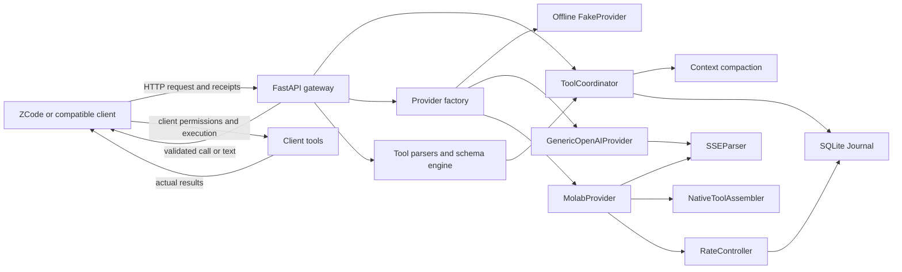
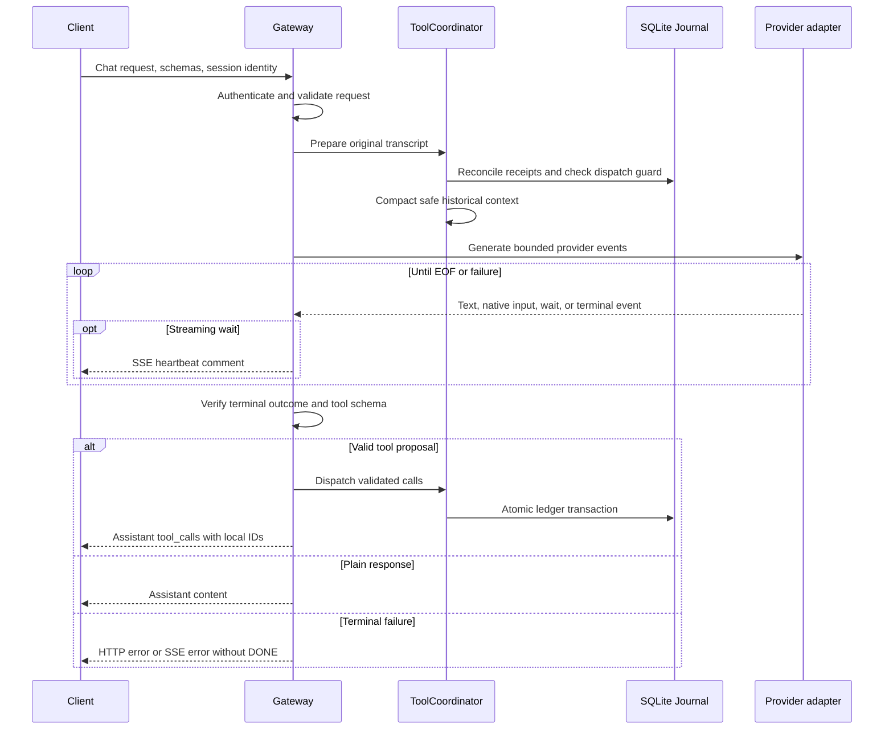
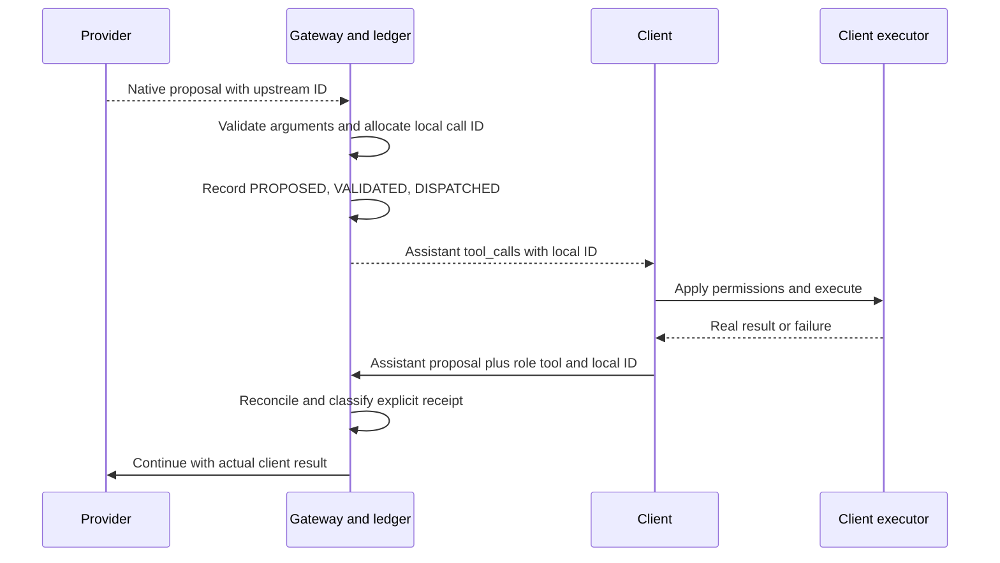
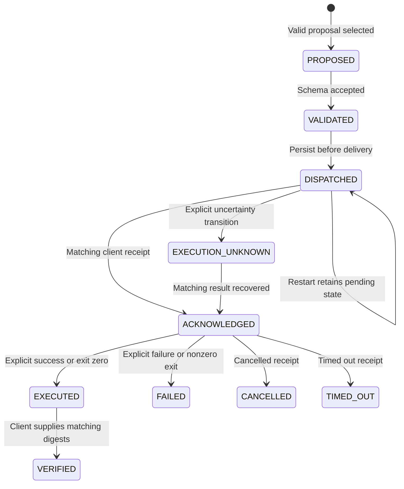

# Architecture

[README](../README.md) · [Configuration](CONFIGURATION.md) · [File guide](FILE_GUIDE.md) · [Development](DEVELOPMENT.md) · [Testing](TESTING.md)

This describes the source in **12.13.0 candidate**, including compatibility paths. Bridge X is a protocol gateway and receipt coordinator. A provider proposes actions, the gateway validates and delivers them, and the requesting client owns permissions and execution. Neither model text nor a dispatched call proves that an action ran.

## Components

`gateway.create_app()` accepts injected providers and journals for tests. Otherwise it uses `Settings.from_env()`, `providers.make_provider()`, and `Journal`. App lifespan shutdown closes the journal. The CLI reserves a loopback socket before Uvicorn starts, reports an occupied port without stopping another process, and performs native Molab setup only for an actual native-provider launch. `--check-config` exits before socket reservation, provider requests, and journal creation.

## HTTP request lifecycle

1. Authenticate the local Bearer key and bound the incoming body to `max_request_bytes`.
2. Decode strict JSON, reject duplicate keys/non-finite values/invalid Unicode, and validate `ChatRequest` with Pydantic.
3. Resolve conversation identity, optional idempotency key, tool registry, and execution scope. Reject impossible forced tool choices before generation.
4. Record bounded request correlation metadata. `ToolCoordinator.prepare()` reconciles receipts from the **original** transcript, checks prior dispatches, and only then compacts history.
5. Run provider preflight, then consume its async event iterator under one absolute gateway deadline. Heartbeats do not cancel the pending upstream read.
6. Require a successful terminal outcome and drain the provider to EOF. Validate complete tool calls, persist their dispatch transaction, then produce JSON or SSE.

`/health` reports the running process; `/ready` is true for the fake provider or after the provider exposes `live_verified`. The generic adapter does not currently set that flag, so a false readiness value is not conclusive evidence of its connectivity. Capability declarations also distinguish an implemented protocol from a native call actually observed in this process. See [the API reference](CONFIGURATION.md#local-http-endpoints).

## Provider abstraction

`capabilities.Provider` declares `generate(req, messages) -> AsyncIterator[object]`. `providers.py` defines immutable event objects: `TextDelta`, `NativeToolDelta`, `Finish`, `Failed`, `RateLimitWait`, and the generic adapter's internal `Done` marker.

| Adapter | Implementation and terminal contract |
|---|---|
| `FakeProvider` | Deterministic offline text/tool-intent simulator. The test client executes any proposed actions. |
| `GenericOpenAIProvider` | Explicit HTTPS Chat Completions endpoint; always requests upstream streaming and optionally forwards declared tools. A unique finish reason **and** `[DONE]` followed by clean EOF are required. It does not implement Molab's transparent rate recovery. |
| `MolabProvider` | Operator-supplied runtime file; native frontend definitions and message parts, optional mode verification, serialized requests, and pacing. Accepts its supported finish or `[DONE]` terminal after clean EOF; incomplete native inputs still fail. |

The factory imports `MolabProvider` lazily. `molab_provider.py` imports native serialization; `native_messages()` lazily imports the provider's content helper. Preserve those import boundaries when extending the adapter. Neither a provider name nor a configured URL is proof of access.

## Native tool-event parsing

`molab_native.native_tools()` preserves client names and parameter schemas, marks definitions `source: frontend`, and advertises manual/agent modes. Forced tool choice limits the offered definitions; `tool_choice: none` offers none. `native_messages()` pairs assistant proposals and real client results into dynamic tool parts; all retained completed pairs keep their actual input/output and output-available state. Context compaction bounds old full pairs before this transformation; completed calls are never rewritten as ordinary assistant claims. Unpaired results are explicitly described as unverified.

`decode_molab_event()` separates text, native events, terminal events, fallback text, and failures. `NativeToolAssembler` requires this progression for each upstream ID:

1. `tool-input-start` with a declared tool name.
2. Zero or more `tool-input-delta` fragments.
3. `tool-input-available` with a complete argument object. If fragments existed, their strict JSON value must agree with the snapshot.
4. Successful stream termination and clean EOF before calls leave the adapter.

Missing starts/completed inputs, duplicate starts, late deltas, oversized input, undeclared notebook tools, and notebook-side `tool-output*` events fail closed. Up to 16 assembled calls are allowed. Native mode never repairs prose or JSON-looking text into an executable tool call.

## Validation and sequential delivery

`tools.validate_native()` and compatibility `parse_intent()` converge on `schema_engine.validate_specs()`. It enforces declared names, forced/disabled choices, count/byte/depth limits, object arguments, and the client's Draft 2020-12 JSON Schema. Remote `$ref`/`$dynamicRef` retrieval is disabled; local references are supported. Error explanations expose safe field names and constraint types rather than argument values.

Compatibility text frames may normalize canonical top-level integer strings where the schema explicitly requests integers. JSON/native calls have one narrow compatibility exception: `Read.offset` and `Read.limit`. Other native arguments retain their types; all normalized values must still satisfy the full schema.

For Molab native/auto requests with `parallel_tool_calls: false`, the gateway selects the first proposal before shared validation and dispatch. Later proposals are discarded, not queued; the model must re-plan after the first receipt. Other multi-call paths are rejected by the shared validator when parallel calls are disabled. Explicit parallel permission allows up to 16 calls but provides no execution ordering guarantee.

## Tool IDs and client receipts

The assembler uses upstream IDs internally. `validate_specs()` creates fresh `call_<uuid>` IDs in `ToolCall`; `ToolCall.openai()` serializes those local IDs for the client. The SQLite ledger and subsequent `tool_call_id` use the **local** ID. There is no persisted upstream-to-client ID mapping.

`receipts.classify_result()` gives precedence to cancellation, timeout, and explicit failure. An integer `exit_code` or explicit boolean `success` can establish a reported outcome. Recognized shell tools require a real integer exit code for success; a generic success flag without it remains unknown. Plain stdout, a boolean masquerading as an exit code, or prose saying “done” remains `unknown`. A received unknown result can reach `ACKNOWLEDGED`; it does not become `EXECUTED`.

The verification endpoint compares **two digests supplied by the client**, checks conversation ownership and the allowed state transition, and records `VERIFIED`. It does not independently read a file, execute a check, or compare against a previously stored expected digest. Receipt and verification trust therefore ends at the authenticated client.

## SSE pipeline

`SSEParser` incrementally decodes strict UTF-8 across byte boundaries, handles CR/LF/CRLF, comments, event names, multiline data, and size limits. EOF is not a blank-line delimiter: unterminated events are discarded. Molab additionally supports the retained `0:`, `e:`, and `d:` legacy records.

Adapters defer success until the entire upstream stream has been checked. An error after a provisional finish overrides it; duplicate terminals and post-finish content are rejected. The gateway independently validates event ordering and output bounds.

With tools enabled, executable deltas and speculative text are buffered until validation. With tools absent or disabled, text can stream immediately. Validated calls are emitted with a call/name delta and argument chunks of at most 1024 characters. Normal completion ends with a finish chunk and `data: [DONE]`. Failure emits `event: error` and returns without that success marker. Clients must handle a failure inside HTTP 200 and must not interpret heartbeat comments as model content.

## Persistence and recovery

`Journal` uses SQLite, an in-process reentrant lock, a busy timeout, and WAL for disk files. Its startup migration retains legacy intent metadata and adds execution scopes; `PRAGMA user_version` is 4 (nullable argument digest and diagnostic metadata columns migrate in place). `deliver()` uses `BEGIN IMMEDIATE` so the duplicate-request check and insertion of a batch are atomic across connections.

| Table | Stored responsibility |
|---|---|
| `intents` | Legacy-compatible proposal ID, owner, name, schema hash, receipt status/kind. |
| `operations`, `operation_events` | Current operation state, provenance, scope, and transition history. |
| `dispatch_requests` | Request fingerprints for already delivered tools. |
| `client_requests` | Validated request correlation identifiers, source, scope, and tool count. |
| `diagnostics`, `upstream_failures` | Bounded phases, error codes, and allowlisted numeric counters. |
| `provider_control` | Lazily created shared Molab cooldown, start time, failures, interval, and last-limit timestamp. |

Prompts, full arguments, stdout, raw upstream bodies, and credential headers are not stored in these ledger fields. Conversation identifiers and tool names still deserve local privacy protection. This is an operation ledger, not a complete transcript backup.

This diagram shows the main receipt path and supported uncertainty state. Restart itself does **not** change `DISPATCHED` to `EXECUTION_UNKNOWN`; the request guard returns an error with that code while preserving the pending record. Rejection/cancellation transitions also exist in the state model; ordinary invalid proposals fail before `deliver()` creates their rows.

`ToolCoordinator` hashes semantic input and scope when there is a conversation identity or idempotency key. Streaming/SDK option changes do not create a new logical action. With an explicit idempotency key, the fingerprint instead uses that key, owner, and scope. Already dispatched request keys remain guarded even after a successful receipt: send the progressed transcript with a new logical request key for the next action. Without either identity mechanism, durable request deduplication is weaker.

At restart, use the same journal and client session identity. Present the original assistant-call/result pairs so `reconcile_client_history()` can reconstruct missing metadata before compaction. A standalone unmatched result is retained as `UNVERIFIED_CLIENT_RESULT` / `EXECUTION_UNKNOWN`, not invented as a known successful proposal. Ownership or renamed-ID conflicts are rejected. Restored transcript evidence is still client-provided evidence.

Never clear a pending journal record to force another mutation. Inspect `/v1/operations/{call_id}`, check the real effect through the client, and supply the actual receipt. The gateway neither reruns uncertain actions nor guarantees exactly-once execution by an external client.

## Execution scopes and rate recovery

`execution_scope.resolve_execution_scope()` keeps `main_turn` stable and derives non-main scopes from the query source plus a digest of history through the last user message. `x-zcode-query-source` distinguishes background jobs without changing conversation ownership. Pending foreground actions do not block a different memory scope, while a pending action still blocks its own scope. Receipt ownership remains conversation-based; scopes are coordination metadata, not authorization boundaries.

`RateController` gives foreground requests priority over the known memory/title background sources and admits one Molab generation at a time. Cooldown/pressure metadata persists under the shared `molab` provider key, including across runtime rotation. Scheduling locks and priorities remain process-local; multiple gateway processes do not form a distributed quota controller.

CLI defaults allow at most **two extra attempts** only with native mode verification and pacing enabled. A recognized HTTP 429 or explicit SSE rate rejection must occur before text, fallback text, native input, or a terminal event. Retries also must fit the one total deadline and cooldown. The HTTP stream and locks are released before the next attempt. Partial output, unknown transport outcomes, incomplete streams, and explicit exhausted quota are never transparently retried. Longer explicit upstream retry hints take precedence over the fallback backoff.

## Security boundaries

- The CLI binds `127.0.0.1`. Authenticated endpoints share one local key; there is no per-user permission model. Health/readiness are unauthenticated.
- JSON Schema checks shape, not shell safety, path authorization, or user intent. The client must enforce its own permissions.
- Molab settings come from an explicit operator file. HTTP clients disable environment proxy inheritance and automatic redirects; the generic adapter requires HTTPS in environment-based configuration.
- Native CLI startup may change the configured runtime from `code_mode` to `manual`. Syntax checking alone never does so.
- The test runner executes only temporary test Python programs and is not imported by runtime gateway modules. It is not an OS security isolation mechanism.
- Treat upstream text, project files, tools, and receipts as untrusted content. Do not publish raw headers, sessions, transcripts, or journal files. See [SECURITY.md](../SECURITY.md).

The module-by-module import map is in the [file guide](FILE_GUIDE.md#runtime-module-dependencies).
