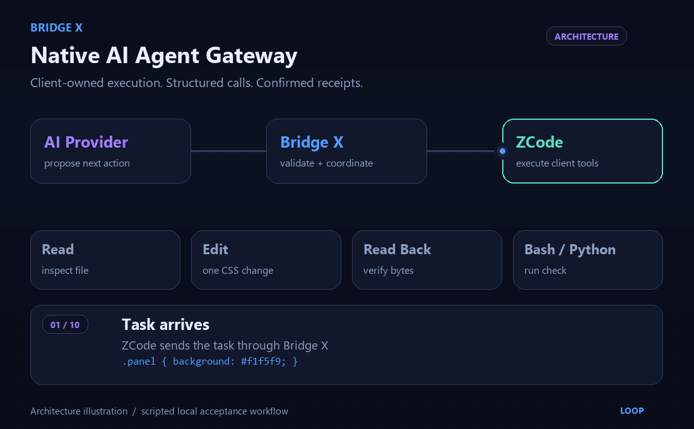
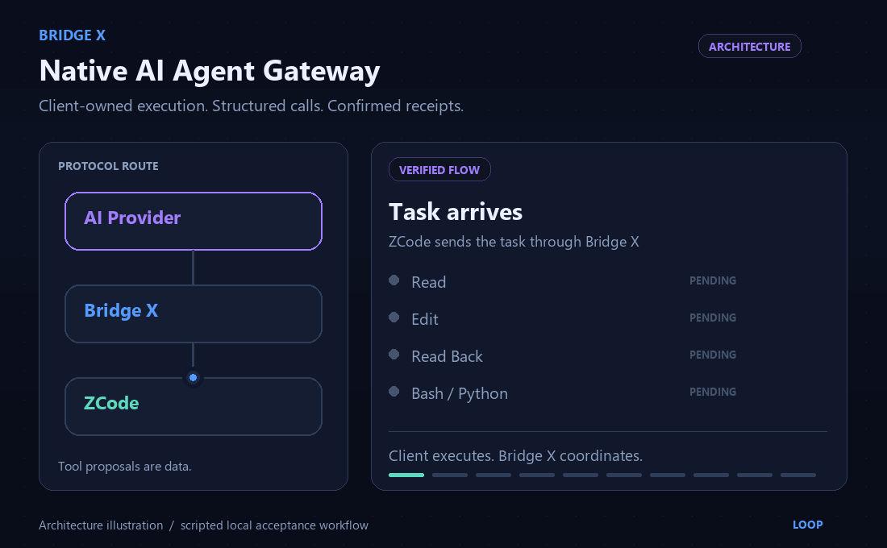

# Animated architecture demo

[README](../README.md) · [Architecture](ARCHITECTURE.md) · [Testing](TESTING.md)

Both GIFs are **programmatically authored architecture illustrations**, not recordings of a running ZCode application. Screen recording was unavailable through the accessible browser-control surface. No user desktop, private project, token, runtime URL, or live model session was recorded.

## Variant 1 — Protocol lanes



The README default shows AI Provider → Bridge X → ZCode as separate responsibilities, then highlights Read, Edit, Read Back, Bash/Python, receipts, and completion. Moving message indicators show request/proposal/result direction. The CSS fixture changes only `#f1f5f9` to `#e0f2fe`.

## Variant 2 — Execution ledger



The alternative emphasizes the protocol route and each tool's receipt state. Both use the verified Read → Edit → Read → fixed Python-check scenario in `tools.native_css_acceptance`; its provider events are scripted, while file changes and Python execution are real temporary client actions. They do not imply that Bridge X runs client tools or that a proposal confirms execution.

## Media specification and recreation

Each animation is **1100 × 680**, **14.4 seconds**, rendered at **12.5 FPS**, endlessly looped. The 180 rendered frames become 178 stored GIF frames as identical holds coalesce; 167 decoded images are distinct. A shared indexed palette and no dithering reduce file size and visual shimmer. The final frames smoothly blend back to the first frame, with identical first/last decoded images. The source asserts text-column/frame bounds and checks motion, loop metadata, duration, dimensions, and a size below 10 MB.

Optional authoring commands, separate from runtime dependencies:

```powershell
python -m venv .media-venv
.\.media-venv\Scripts\python.exe -m pip install -r tools/requirements-media.txt
.\.media-venv\Scripts\python.exe -m tools.render_demo
```

The renderer uses Segoe UI on Windows or DejaVu on Linux. Font availability can affect exact rendered bytes; committed GIFs are the reviewed assets. Generated preview sheets and review reports stay outside the repository. Pillow is not added to `requirements.txt` or `requirements-dev.txt`.
